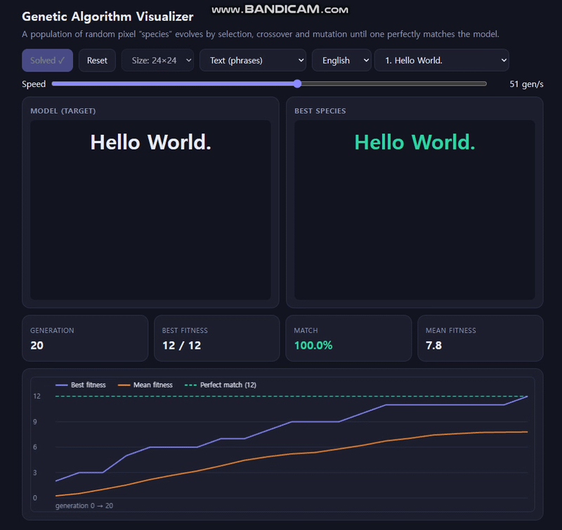
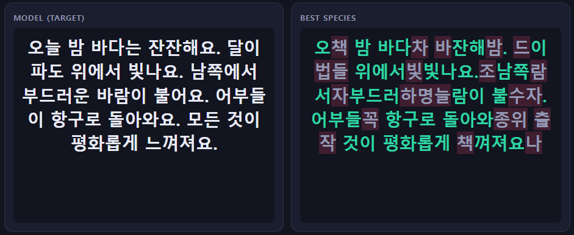
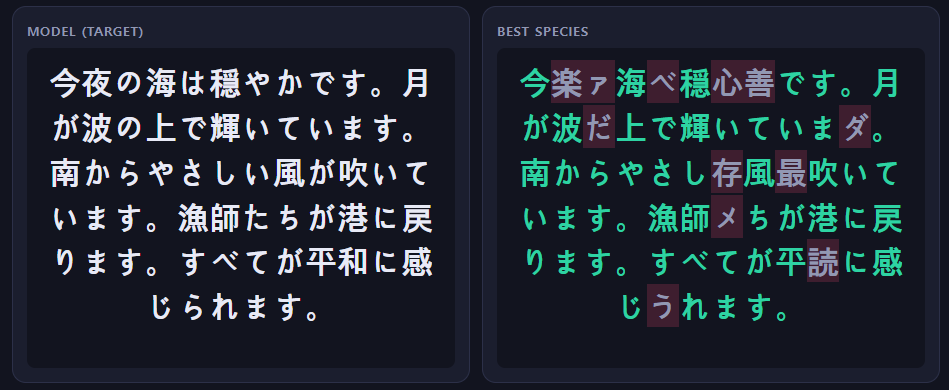
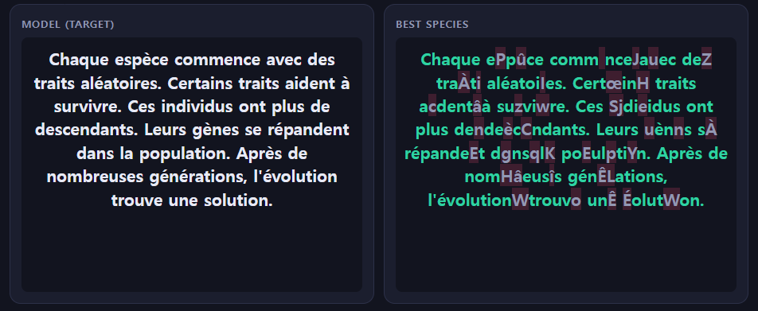
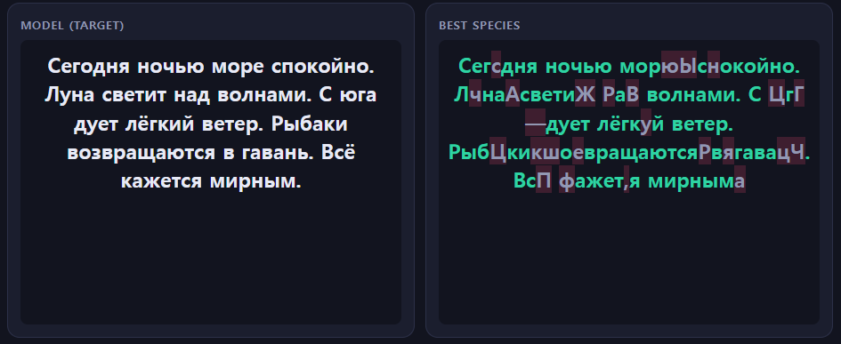
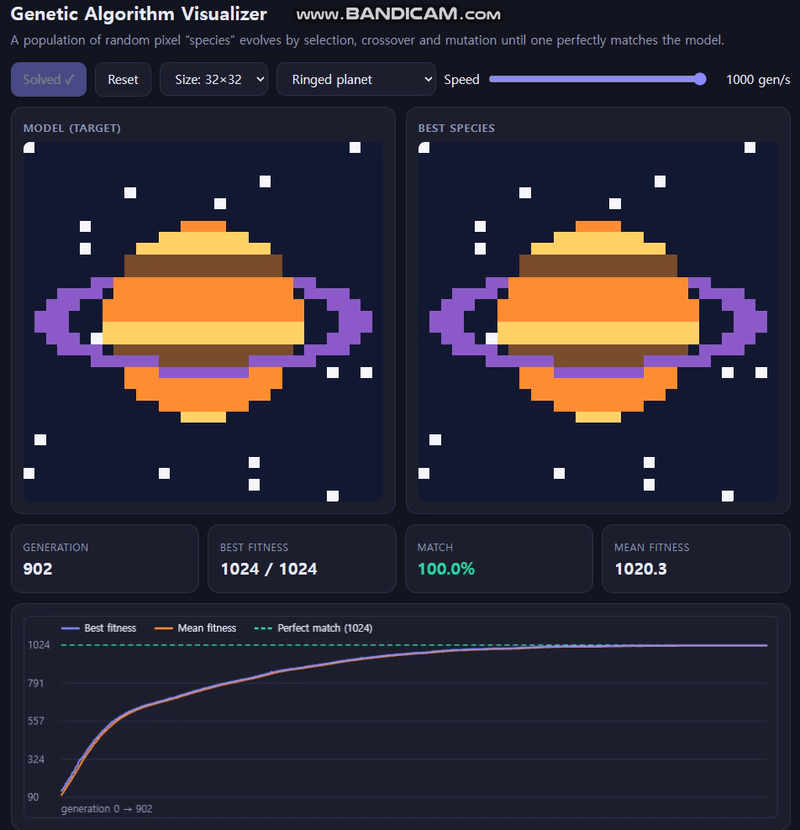
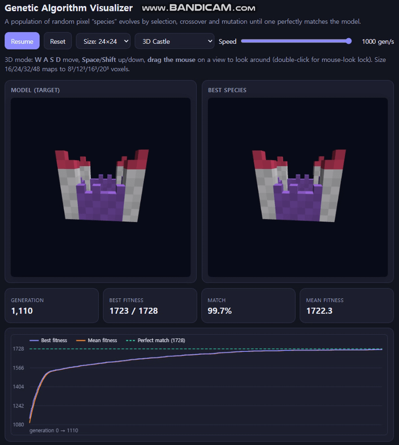

# Genetic Algorithm Visualizer

An interactive browser-based visualizer that demonstrates how a genetic algorithm evolves a population of random candidates—using selection, crossover, and mutation—to match a target model across **2D pixel art**, **multilingual text**, and **3D voxel structures**.















## Features

- **Multiple Target Domains:**
  - **2D Pixel Art:** *Heart*, *Smiley*, *Tree*, *Invader*, *Sunset landscape*, *Ringed planet*, *Mushroom*, *Flower*, and *Rainbow sky* across grid sizes `16×16`, `24×24`, `32×32`, and `48×48`.
  - **Text Evolution:** Evolve phrases of varying lengths across 10 languages (*English*, *Deutsch*, *Español*, *Français*, *Русский*, *한국어*, *日本語*, *中文*, *العربية*, and *ไทย*), with color-coded character matching and automatic font scaling.
  - **3D Voxel Models:** *3D Sphere*, *3D Pyramid*, *3D Torus*, *3D Tree*, *3D Castle*, *3D Mushroom*, and *3D DNA helix* rendered with a WebGL 2 cube/face renderer (`8³`, `12³`, `16³`, and `20³` voxel resolutions).
- **Genetic Algorithm Controls:**
  - Tournament selection (`TOURN = 3`), elitism (`ELITE = 2`), uniform crossover, and per-gene mutation.
  - Adjustable simulation speed (`gen/s`), **Stop / Resume**, and **Reset** controls.
- **Live Telemetry & Charting:**
  - Real-time metrics for **Generation**, **Best fitness**, **Match (%)**, and **Mean fitness**.
  - Canvas fitness chart tracking best fitness, mean fitness, and the target match threshold over generations.
- **Interactive 3D Camera (in 3D mode):**
  - Move with `W`, `A`, `S`, `D`, ascend/descend with `Space` / `Shift`, drag on a canvas to look around, or double-click a canvas to request pointer lock.

## Project Structure

```text
├── index.html   # Page layout, controls, canvases, and text containers
├── styles.css   # Responsive styling, theme support (light/dark), and layout rules
└── app.js       # GA engine, 2D/text/3D model generators, WebGL 2 renderer, and chart
```

## Getting Started

No build step or external dependencies are required.

1. Clone or download the repository files (`index.html`, `styles.css`, `app.js`).
2. Serve the folder over a local static server or open `index.html` in a modern browser with WebGL 2 support:
   ```bash
   npx serve .
   ```
   *(or `python3 -m http.server`)*

## Browser Compatibility

- Requires a modern browser supporting **HTML5 Canvas** and **WebGL 2** (for 3D voxel mode).
- Supports automatic light/dark appearance via `prefers-color-scheme` as well as explicit `[data-theme="light"]` / `[data-theme="dark"]` attributes on `:root`.